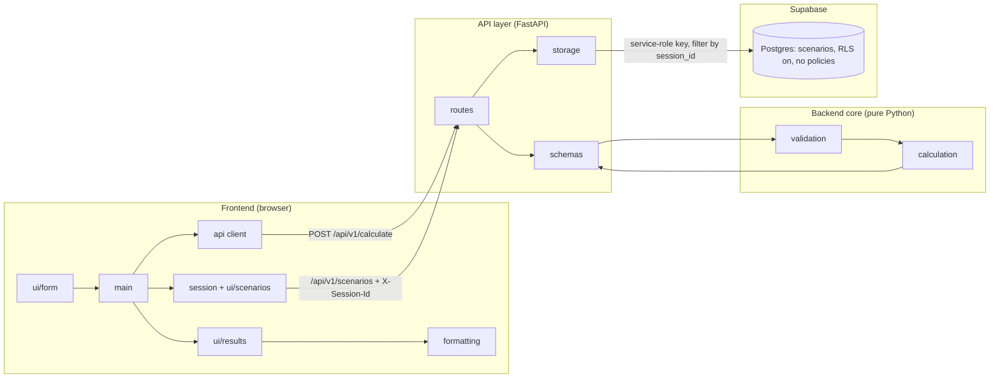
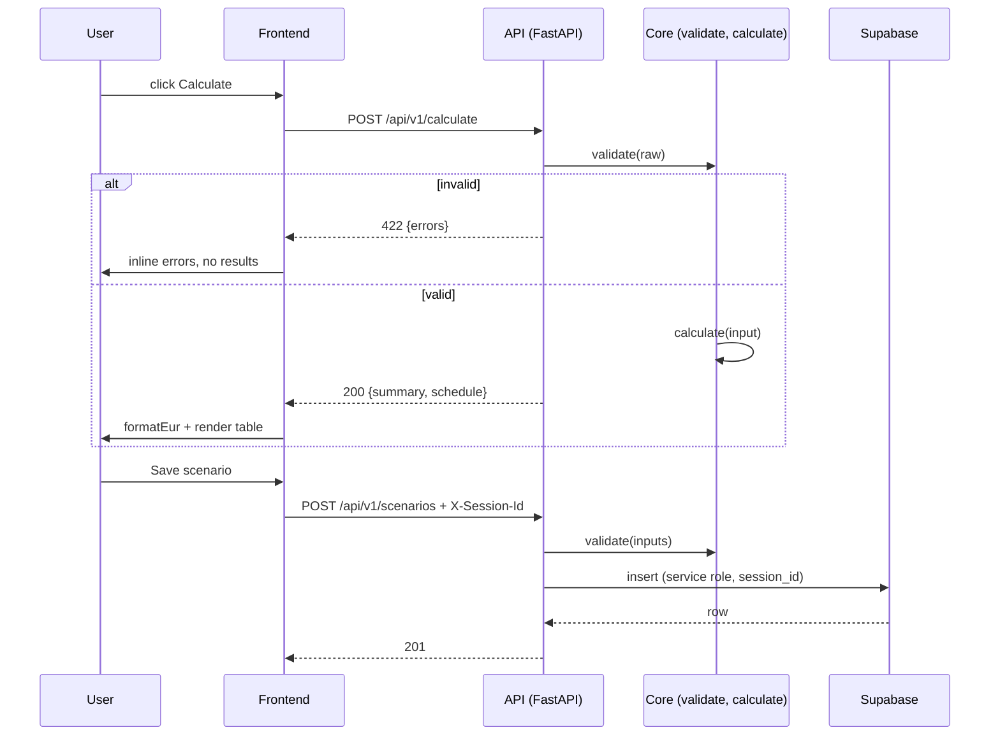

# 02 - Architecture (V2): frontend / API / Python backend / Supabase (anonymous sessions)

Update of `docs/v1/02-architecture.md`. V1 is a single client-side JS app. V2 splits it into four tiers: **frontend** (browser), **API** (HTTP boundary), **backend** (Python calculation core) and **Supabase** (Postgres for saved scenarios). Calculation behaviour (inputs, formulas, rounding, outputs) is unchanged from `docs/v1/01-functional.md`; new in V2 is saving/loading scenarios per anonymous session (no accounts) (see `01-functional.md` in this folder). Draft for review - nothing is built.

## 1. Assumptions

- Calculation feature set as V1. New: **saved scenarios** (named sets of the six inputs). No user accounts and no login: a scenario belongs to an anonymous **session id**. Export and sharing stay out of scope.
- Session id = random UUID v4 generated by the browser on first visit, kept in `localStorage`, sent as `X-Session-Id`. It acts as an unguessable bearer value: anyone holding it sees that session's scenarios; clearing browser data loses access. Nothing else identifies a user (no email, no IP stored).
- Only **inputs** are stored, never results: results are recomputed on load, so stored rows cannot drift from the formulas.
- Python >= 3.11. Backend framework: **FastAPI + uvicorn + pydantic** (installed in `backend/.venv`; pinned in `backend/requirements.txt`).
- Frontend stays plain JS/HTML/CSS (ES modules), no build step, served as static files by the API (same origin). The browser never talks to Supabase.
- Backend is stateless: no server-side sessions. Identity = the `X-Session-Id` header.
- Supabase is hosted (one project; local stack via Supabase CLI for development). Existing project `mortgage_calculator` (id `dapqejeusrqpdhxhnbrh`, eu-central-1, empty at the time of writing). Secrets (`SUPABASE_URL`, `SUPABASE_SERVICE_ROLE_KEY`) live in `backend/.env` (git-ignored; `backend/.env.example` lists names only). The service-role key is used **only by the backend**, never sent to the browser.
- Local deployment first (`localhost`); hosting/CI/CD is out of scope here.

## 2. Tiers



| Tier | Responsibility | Knows about |
|---|---|---|
| Frontend | Collect fields, show inline errors, render summary + table, EUR formatting (half-up 2 dp), session id, scenario list | API contract only |
| API | HTTP transport, JSON, status codes, session-id check, error shape, calls storage. **No business logic** | backend core, storage |
| Backend core | Authoritative validation and all financial math. Pure functions, no HTTP/framework imports | nothing |
| Supabase | Persistence (Postgres) only. RLS on with no policies: public API roles get nothing; only the backend reads/writes | nothing |

## 3. Repository layout

```
frontend/
  index.html
  styles.css
  src/
    main.js              composition root
    api.js               fetch wrapper for /api/v1/*, attaches X-Session-Id
    session.js           get-or-create session id (localStorage)
    formatting.js        formatEur (unchanged from V1)
    constants.js         limits mirrored for UX hints only
    ui/form.js
    ui/results.js
    ui/scenarios.js      save / list / load / delete scenarios
backend/               (built first; see docs/handoff.md)
  app/
    main.py              FastAPI app, static mount of frontend/, CORS (dev only)
    config.py            env settings
    api/routes.py        /api/v1/calculate, /scenarios, /health; pydantic input shapes
    storage/             base (interface), memory (dev/tests), supabase (PostgREST)
    api/serialization.py MortgageResult -> JSON strings
    core/
      constants.py       limits (single source of truth)
      validation.py      RawInput -> LoanInput | FieldErrors
      calculation.py     LoanInput -> MortgageResult
      types.py           dataclasses
  tests/
    test_core.py         validation + calculation vs docs/v1/reference_values.py
    test_api.py          endpoints, memory store, mocked Supabase
supabase/
  migrations/            SQL: schema + RLS
tests/                   existing JS tests (formatting, UI)
.env.example
docs/v1/  docs/v2/
```

V1 `src/validation.js` and `src/calculation.js` move to the backend. Their JS tests are ported to `pytest` and reuse `docs/v1/reference_values.py`.

## 4. Module responsibilities

### 4.1 Backend core (`backend/app/core`)
- `constants`: `MAX_PRICE = 10**12`, rate 0..25, term 1..40, 2 dp, tax/insurance cap (A5).
- `validation.validate(raw: dict[str,str]) -> LoanInput | FieldErrors`. Operates on **strings** (as V1: detects >2 dp, `1e3`, `,`). Order unchanged: required -> numeric -> range -> precision, plus `down < price`.
- `calculation.calculate(inp: LoanInput) -> MortgageResult`. Uses `decimal.Decimal` (exact), replacing the V1 BigInt fixed point. Unrounded annuity payment, explicit `r = 0` branch, final-payment adjustment so `balance_n = 0`.
- No rounding in the backend ("round late" kept).

### 4.2 API (`backend/app/api`)
- `/calculate` calls `validate`, then `calculate`, then serialises.
- Pydantic models describe **shape** only (all fields `str`); semantic validation stays in `core.validation`. The framework's default 422 body is replaced by the error shape in section 5.
- `session_id` dependency: requires `X-Session-Id` to parse as a UUID, else 400.
- `storage/scenarios.py`: thin repository behind an interface (`list/create/update/delete`), implemented with PostgREST calls (service-role key, every query filtered by `session_id`). Swappable for an in-memory fake in tests.

### 4.3 Frontend
- `api.js`: `calculate(raw) -> {ok:true,result} | {ok:false,errors} | {ok:false,networkError}`. Network/5xx shown as a banner, not as field errors.
- `main.js` flow: clear -> `collect` -> `api.calculate` -> show errors or `render`. Calculate disabled while in flight; stale responses ignored.
- `session.js` / `ui/scenarios.js`: saving uses the same `collect()` + server validation.
- `formatting.js` stays in the frontend (presentation); API returns unrounded values.
- Client-side validation is **not authoritative**; optional UX hints only.

## 5. API contract

Money values are JSON **strings** (decimal, full precision), so nothing is lost crossing JSON/IEEE doubles (cap 1e12 with cents). `formatEur` accepts the string directly (V1 already rounds half-up on the shortest decimal string).

**Request** `POST /api/v1/calculate` (no auth needed)
```json
{ "price": "300000", "downPayment": "60000", "annualRate": "4.5",
  "termYears": "30", "annualTax": "3000", "annualInsurance": "" }
```

**200 OK**
```json
{
  "summary": {
    "principal": "240000",
    "monthlyPI": "1216.0414...", "monthlyTax": "250", "monthlyInsurance": "0",
    "monthlyTotal": "1466.0414...",
    "totalPaid": "437774.9...", "totalInterest": "197774.9..."
  },
  "schedule": [
    { "month": 1, "payment": "1216.04...", "interest": "900", "principal": "316.04...", "balance": "239683.9..." }
  ]
}
```
`schedule.length === termYears * 12`; last `balance` is `"0"`.

**422** (validation failure; maps 1:1 to `FieldErrors`)
```json
{ "errors": { "annualRate": "Rate must be between 0 and 25.", "downPayment": "Down payment must be less than the price." } }
```

**Other:** `400` malformed JSON / missing body; `500` programmer error (generic message, details in server log). Versioned by path (`/api/v1`). Contract documented by generated OpenAPI at `/docs`.

### 5.1 Scenario endpoints (anonymous session)

All need `X-Session-Id: <uuid>`; `400` if missing or not a UUID.

| Method + path | Body | Success |
|---|---|---|
| `GET /api/v1/scenarios` | - | `200 [{id, name, inputs, updatedAt}]` |
| `POST /api/v1/scenarios` | `{name, inputs: RawInput}` | `201 {id, name, inputs, updatedAt}` |
| `PUT /api/v1/scenarios/{id}` | `{name, inputs}` | `200` same shape |
| `DELETE /api/v1/scenarios/{id}` | - | `204` |

- `inputs` is validated by `core.validation` before storing; failure -> `422 {errors}` (same shape as calculate). `name`: 1-60 chars, trimmed.
- Unknown id or another session's id -> `404` (ownership is never revealed). A malformed id -> `400`.
- Max 50 scenarios per session (`409` beyond). Fields longer than 32 chars -> `422`.

## 6. Supabase

### 6.1 Schema
See `supabase/migrations/20261015000000_scenarios.sql` (written, **not yet applied** to the project):
`scenarios(id uuid pk, session_id uuid not null, name text 1-60, inputs jsonb, created_at, updated_at)`, index on `(session_id, updated_at desc)`, `updated_at` trigger, RLS enabled with **no policies**, `revoke all ... from anon, authenticated`.

### 6.2 Access flow
- The browser sends `X-Session-Id` to the API only. The API uses the service-role key (bypasses RLS) and always filters by `session_id`.
- The service-role key lives only in `backend/.env`. With RLS on and no policies, the project's public REST API and anon key cannot read or write the table.
- Anonymous users can call `/calculate`; no session id needed.
- Risk: the session id is a bearer secret (see section 1). Acceptable for non-sensitive loan parameters; stated limitation.

### 6.3 Why through the API and not browser -> Supabase directly
No auth means the browser cannot be given direct table access safely. Saves also pass the same server-side validation as calculation.

## 7. Data flow



## 8. Key decisions

| Decision | Rationale |
|---|---|
| Validation + calculation only in Python | One implementation; frontend cannot drift |
| Validate strings server-side | Preserves V1 behaviour for `>2 dp`, `1e3`, `,` |
| API has no logic; core has no framework imports | Core testable with plain `pytest`; framework replaceable |
| Money as decimal strings in JSON | No float loss (V1 R3/R5 exactness goal) |
| Rounding stays in frontend `formatting` | "Round late, one place" rule |
| `/api/v1` prefix | Later breaking changes without breaking clients |
| 422 + `{errors: {field: msg}}` | Feeds `ui/form.showErrors` unchanged |
| ~480-row response in one call (~50-100 KB) | Small; no pagination |
| Same-origin serving (API mounts `frontend/`), CORS only for dev | No CORS config in normal case |
| Anonymous session id, no accounts | Matches requirement; nothing personal stored |
| Service-role key in backend only; RLS on, no policies | Public API cannot touch the table; one trusted access path |
| Store inputs only (jsonb), not results | Always recomputed with current formulas; tiny rows |
| Scenarios saved via the API, not directly from the browser | Same validation path; one contract |
| Schema as SQL migrations in git | Reviewable, reproducible |
| `/calculate` has no DB/auth dependency | Calculator keeps working if Supabase is down |

## 9. Error handling

- Invalid input: 422 with field errors, never 5xx. Frontend shows them inline, results stay empty (F6).
- Network failure / 5xx / timeout on calculate: banner "Calculation service unavailable"; results cleared; no invented field errors.
- Supabase unreachable on scenario endpoints -> `503`; calculation unaffected.
- Missing/invalid session id -> `400`.
- Backend core raises only on precondition violation (bug) -> 500 + log.
- Request size limit and max field length (e.g. 32 chars) at the API.

## 10. Testability

- Core: `pytest` (port VAL-*, CAL-* from `docs/v1/03-test-scenarios.md`; invariants from V1 section 8).
- API: `pytest` + FastAPI `TestClient`: 200/422/400/401/404 shapes, health, string-money round-trip at the 1e12 cap; scenario endpoints against an in-memory fake storage.
- Supabase store: unit-tested against a mocked PostgREST (`httpx.MockTransport`); a real-project smoke test after the migration is applied and keys are provided. Check with the anon key that the table returns nothing.
- Frontend: existing JS tests for `formatting`; DOM tests for form/results/scenarios with `api.js` stubbed.
- Contract test: shared JSON fixtures used by Python API tests and JS `api.js` tests (when the frontend is migrated).

## 11. Migration from V1 (suggested order)

1. Port `validation` + `calculation` to `backend/app/core`; parity with V1 reference values via `pytest`. **Done.**
2. Add API layer (`/calculate`, `/health`) + tests. **Done.**
3. Scenario endpoints, storage (memory + Supabase), migration file. **Done** (migration not applied).
4. Add `frontend/src/api.js`, `session.js`, `ui/scenarios.js`; switch `main.js` to the API; remove JS `validation`/`calculation`.
5. Move static files into `frontend/`; update README, scripts, `docs/handoff.md`.
6. Update stages 03-06 under `docs/v2/` per the project stage order.

## 12. Out of scope / extension points

- Accounts/login, sharing scenarios between sessions, export, expiry/cleanup of old sessions' rows.
- Extra payments / variable rates: new endpoint or optional request fields; `ScheduleRow` stays stable.
- Containerisation, hosting, GitHub Actions CI (`pytest` + `npm test`).

## 13. Decisions taken / open questions

Taken:
1. FastAPI stack, money as decimal strings, same-origin serving, Node only for frontend tests, V2 `01-functional.md` as a delta.
2. Supabase project `mortgage_calculator` (existing); no accounts, anonymous session id; service-role key backend-only.
3. Backend first.

Open:
1. Apply the migration to the project (outward-facing change; needs your go-ahead) and provide `SUPABASE_URL` + service-role key in `backend/.env`.
2. 50-scenario cap per session acceptable?
3. Clean up old sessions' rows (e.g. delete after 90 days)? Free-tier projects also pause after inactivity.
